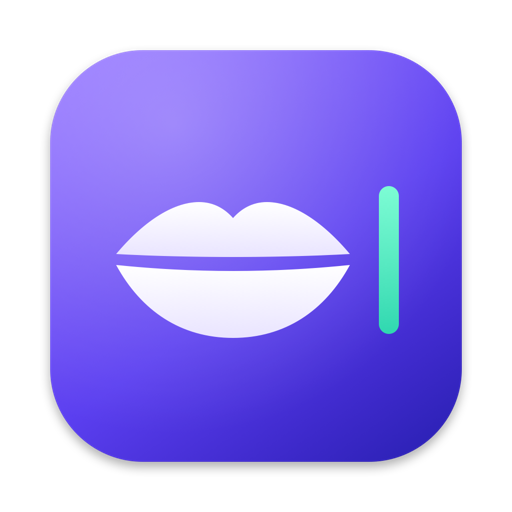
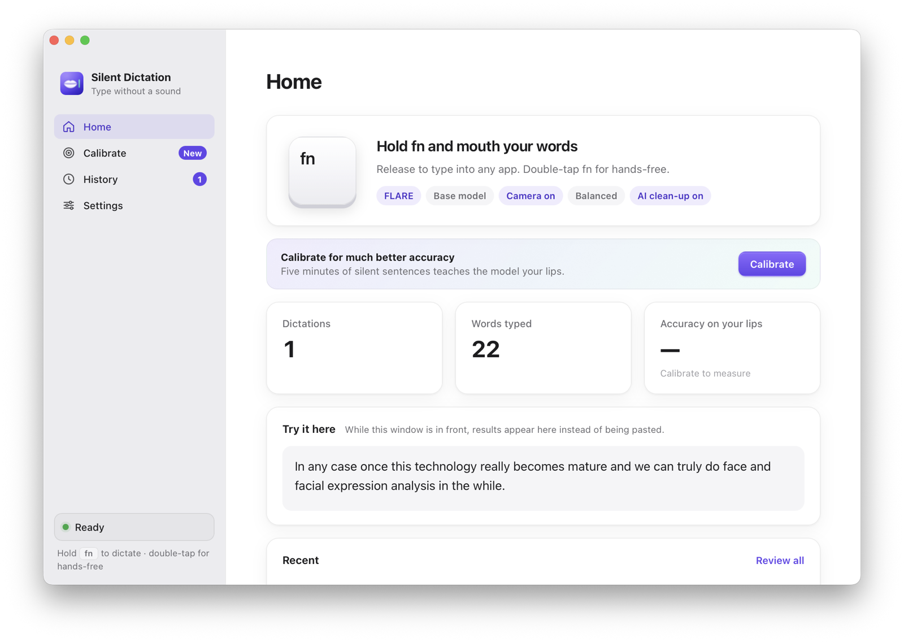
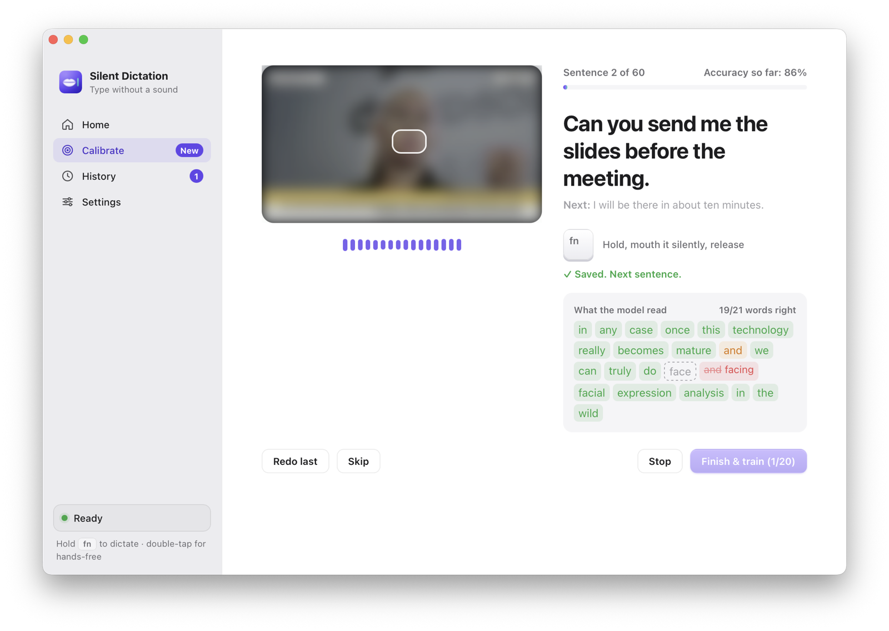
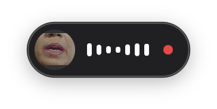
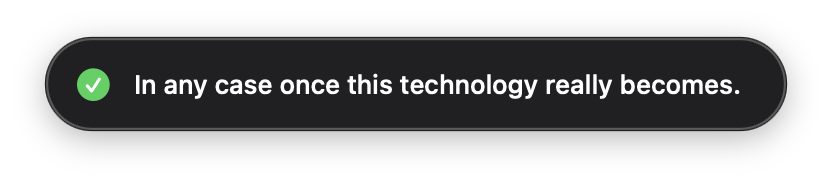
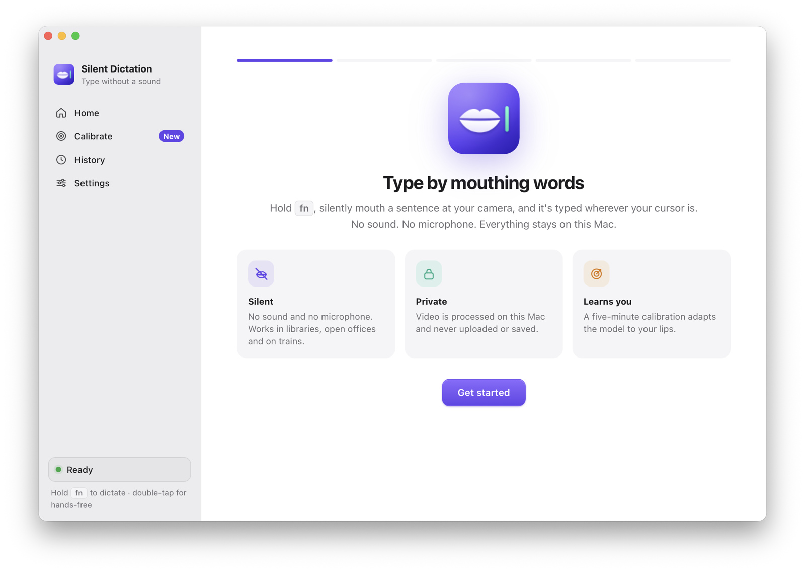
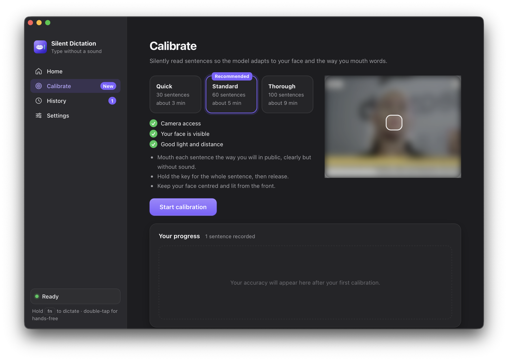
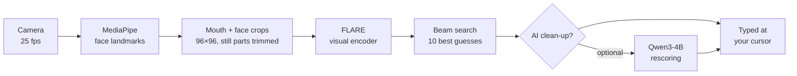

<p align="center">
  
</p>

<h1 align="center">Silent Dictation</h1>

<p align="center">
  <b>Type by mouthing words. No sound, no microphone, no wearable.</b><br>
  Hold <kbd>fn</kbd>, silently mouth a sentence at your Mac's camera, release, and it's typed at your cursor.<br>
  Lip reading runs entirely on your Mac.
</p>

<p align="center">
  Inspired by <a href="https://x.com/AarushYadav47/status/2116198463847408066">@AarushYadav47's Subvocal</a> · not affiliated
</p>

<p align="center">
  <a href="https://github.com/KeWang0622/silent-dictation/actions/workflows/ci.yml"></a>
  
  
  
  <a href="LICENSE"></a>
</p>

<p align="center">
  
</p>

Voice dictation apps like Willow Voice and Wispr Flow are fast, but they need you to talk out loud, which doesn't work in a library, an open office or on a train. Silent Dictation works the same way (hold a key, speak, release) except you don't make a sound: it reads your lips through the camera you already have and types what you mouthed into any app.

> **Inspiration.** This project started after seeing [Aarush Yadav's (@AarushYadav47) Subvocal announcement](https://x.com/AarushYadav47/status/2116198463847408066) (YC F26): glasses that read silent speech with non-contact sensing. I often sneak into an empty room at the office just to dictate, and I already wear glasses, so I wanted to see how far a plain Mac camera and open lip-reading models can go today, with nothing extra to wear. Silent Dictation is an independent open-source project and is **not affiliated with Subvocal**.

> **Status: early, and improving fast.** Everything works end to end on your Mac, including calibration and training a personal model. Version 0.3 switched to the [FLARE](https://arxiv.org/abs/2610.19559) lip reader, which cut the word error rate on 120 sentences from 12 speakers (public VidTIMIT dataset) from 47.5% to 32.7%, and to 30.7% with on-device language-model rescoring. That still means about one word in three is wrong, and silent mouthing is harder than the voiced speech in that test, so calibrate before you judge it. See [Accuracy](#accuracy-and-limitations) for the numbers. Ideas and pull requests are very welcome.

## Highlights

- **Feels like Willow.** Hold <kbd>fn</kbd> to dictate, double-tap for hands-free, press again to stop. <kbd>fn</kbd> plus another key cancels, so your normal shortcuts keep working. Prefer another key? Pick Right ⌥, Right ⌘ or Right ⌃.
- **Reads your lips and your face.** The FLARE model looks at a tight mouth crop and a wider face crop together. It makes about 30% fewer mistakes than Auto-AVSR, the lips-only model in earlier versions.
- **A floating indicator** shows a live view of your mouth and lip activity while it reads, then the result.
- **Learns your lips.** A five-minute calibration has you mouth short sentences while it shows, word by word, what the model read. Bad takes (too short, lips barely moved, face lost) are rejected on the spot. Then it fine-tunes a personal model on your Mac and keeps it only if it beats the base model on sentences it never trained on.
- **Gets better as you use it.** Correct a dictation in History with one click and it becomes training data for the next round.
- **Private by design.** Video is processed in memory and never uploaded. History keeps only small grey mouth crops so you can review and retrain, and you can turn that off.
- **Quick.** The encoder runs on the Apple GPU and beam search on the CPU: about 0.2 s to read a typical sentence on an M5 Max, or 0.6 s with AI clean-up.
- **AI clean-up that can't make things up.** A small on-device language model (Qwen3-4B via MLX) scores the lip reader's ten best guesses and helps pick the most natural one, such as "five" over "fine". It never writes words of its own. In Auto mode it stays on unless calibration shows it doesn't help you.

<p align="center">
  
</p>

<p align="center">
  
  &nbsp;&nbsp;
  
</p>

<table>
  <tr>
    <td></td>
    <td></td>
  </tr>
  <tr>
    <td align="center">A short setup guide for permissions, camera and key</td>
    <td align="center">Light and dark mode</td>
  </tr>
</table>

## How it works



1. While you hold the key, the camera tracks 478 face landmarks per frame with MediaPipe and cuts two 96×96 grey crops, resampled to 25 fps by real timestamps: a stabilised crop of your mouth and a smoothed, wider crop of your face.
2. Stretches at the start and end where your lips don't move are trimmed, so the model doesn't invent words for them.
3. The [FLARE](https://github.com/jxzhanggg/FLARE) visual speech recogniser (Zhang et al., NeurIPS 2026) reads both crops. Its encoder was trained to reproduce Whisper's speech features from video, and the Large model used here scores 15.9% word error rate on the LRS3 benchmark. Silent Dictation runs its own plain PyTorch port, which needs no fairseq and matches the original model's outputs to within 1e-5. Beam search keeps the ten best transcripts.
4. If the language model is installed, it scores each candidate as something a person might type, and the app picks the best combined lip-reading and language score.
5. The result is pasted into the app you're using. If Accessibility access is off, it goes to the clipboard instead.

The older [Auto-AVSR](https://github.com/mpc001/auto_avsr) model (lips only, 19.1% on LRS3) is still included and can be chosen in Settings, for example to save disk space with `./setup.sh --no-flare`.

Calibration fine-tunes the active model on your own clips with two strategies: a light one (visual front ends, normalisation layers and biases) and a full one at a lower learning rate. Every fifth sentence is held out permanently, and the app keeps whichever of the base model, your previous personal model and the new one reads those held-out sentences best. Training 60 sentences takes about ten minutes on an M5 Max.

## Install

You need an Apple Silicon Mac with macOS 13 or later, about 9 GB of free disk space during setup (5.5 GB afterwards, or 3.4 GB without the AI clean-up model) and [uv](https://docs.astral.sh/uv/) (`brew install uv`).

```bash
git clone https://github.com/KeWang0622/silent-dictation.git
cd silent-dictation
./setup.sh --with-llm   # Python environment + checksum-verified models
bin/build-app     # installs "Silent Dictation.app" in /Applications and opens it
```

`setup.sh` downloads the FLARE checkpoint once (4.8 GB), converts it to a 0.8 GB file and deletes the original. It also fetches Auto-AVSR and MediaPipe (about 1 GB). `--with-llm` adds the AI clean-up model (another 2 GB); leave it out for a smaller install, or use `--no-flare` to skip FLARE. Interrupted downloads resume where they stopped.

`bin/build-app` keeps the code, models and Python environment in `~/Library/Application Support/Silent Dictation/runtime` (as APFS clones, so they take no extra space), which means you can move or delete the source folder afterwards (keep uv's Python, which the app links to). To update, run `git pull`, `./setup.sh --with-llm` and `bin/build-app` again; your permissions and calibration stay. Coming from 0.2, calibrate once more: clips recorded before 0.3 have no face crop, so FLARE learns less from them. Your Auto-AVSR personal model still works if you pick Auto-AVSR in Settings.

On first launch a short setup guide walks you through:

1. **Permissions.** Camera to see your lips, Input Monitoring to notice the key, and Accessibility to type into other apps.
2. **Camera check.** A live preview with a box on your mouth. An iPhone works great as the camera through Continuity Camera.
3. **Your key.** <kbd>fn</kbd> by default. If <kbd>fn</kbd> opens the emoji picker, set *System Settings › Keyboard › Press 🌐 key to › Do Nothing*.
4. **Calibration** (recommended). About five minutes of silent sentences, then a few minutes of training in the background.

## Using it

| Action | What happens |
| --- | --- |
| Hold <kbd>fn</kbd>, mouth a sentence, release | The text is typed where your cursor is |
| Double-tap <kbd>fn</kbd> | Hands-free: keeps reading until you press <kbd>fn</kbd> again |
| <kbd>fn</kbd> + another key | Cancels, so shortcuts like <kbd>fn</kbd> + arrow still work |
| Dictate while the Silent Dictation window is in front | The result shows in *Try it here* instead of being pasted |

Tips for good results:

- Face the camera from about an arm's length away with light on your face. Front light matters more than anything else.
- Mouth clearly, the way you'd want a friend across the room to read your lips, but without sound.
- Short everyday sentences work best. Pause briefly before and after.
- If you also run Willow Voice, Wispr Flow or Superwhisper on <kbd>fn</kbd>, both start at once. Silent Dictation warns you and lets you switch to Right ⌥.

## Accuracy and limitations

Be realistic: lip reading is much harder than speech recognition. Many sounds look identical on the lips (p/b/m, f/v, t/d/n), and the models were trained on TED talks and similar online video, where people speak aloud to a good camera. To track progress, every model change is measured on the same 120 sentences: 12 speakers from the public [VidTIMIT](https://conradsanderson.id.au/vidtimit/) dataset reading 10 sentences each, none of them seen in training, run through the app's own pipeline with base models only.

| Lip reader (Mode) | Word error rate | Sentences fully right | Time per sentence |
| --- | --- | --- | --- |
| Auto-AVSR (default in 0.2) | 47.5% | 15.8% | 0.7 s |
| FLARE, lips only | 36.8% | 19.2% | 0.2 s |
| **FLARE, lips + face (Balanced)** | **32.7%** | **23.3%** | **0.2 s** |
| FLARE + AI clean-up (Balanced) | 30.7% | 30.8% | 0.6 s |
| FLARE + AI clean-up (Accurate) | 30.3% | 31.7% | 0.7 s |

Times are for an M5 Max and leave out face tracking, which runs while you're still mouthing. To reproduce the table, see [benchmarks/](benchmarks/README.md).

Silent mouthing by a new person in front of a laptop camera is harder than this test, which uses voiced speech filmed in a studio, so expect more mistakes in real use, especially before calibration. Calibration is the single biggest improvement for your own lips, and the Calibrate page shows your before-and-after accuracy on held-out sentences.

Current limitations:

- English only.
- Apple Silicon only. Intel Macs would run on the CPU and be slow.
- Beards, masks, strong side light and turning your head reduce accuracy.
- macOS treats each rebuild of the launcher as a new app, so permissions have to be granted again after `bin/build-app --force`.

## Privacy

Everything runs locally and there are no network calls at run time. Camera frames live only in memory. Your data stays in `~/Library/Application Support/Silent Dictation/data`: settings, usage counts, calibration clips and the personal model, and (if *Keep clips for review* is on) small 96×96 grey mouth crops of recent dictations. Delete that folder to erase everything.

## Command line

The app covers everyday use. For scripting and experiments there is `bin/silentdict`:

```bash
bin/silentdict doctor --camera-test       # check models, permissions and the camera
bin/silentdict transcribe clip.mp4        # lip-read a video file
bin/silentdict train                      # retrain your personal model
bin/silentdict eval                       # base vs personal accuracy on held-out sentences
bin/benchmark ~/data/vidtimit --llm       # word error rate on the VidTIMIT sentences
```

`transcribe` and `train` take `--model flare` or `--model auto_avsr`.

## Uninstall

Quit Silent Dictation, then delete `/Applications/Silent Dictation.app` and `~/Library/Application Support/Silent Dictation`. If you turned on *Open at login*, also delete `~/Library/LaunchAgents/io.github.kewang0622.silentdictation.plist`.

## Roadmap

- **Phrase mode** for things you type often. Matching a clip against a list of your own phrases is far more reliable than free reading: in tests with an 84-phrase list, 88% of sentences came out exactly right.
- Parameter-efficient (LoRA) personal adaptation, so more of your data helps without overfitting.
- An LLM decoder in the style of FLARE-LLM (13.2% on LRS3, against 15.9% for the model used now), if it can run fast enough on a laptop.
- Streaming decoding while the key is held, for lower latency on long sentences.
- More languages, starting with Mandarin.
- A signed, notarised download that doesn't need a terminal.

See [docs/RESEARCH.md](docs/RESEARCH.md) for the model survey behind these choices, and [CONTRIBUTING.md](CONTRIBUTING.md) to help.

## Credits

- [Aarush Yadav's Subvocal](https://x.com/AarushYadav47/status/2116198463847408066) for the idea of typing by silent speech. Not affiliated.
- [FLARE](https://github.com/jxzhanggg/FLARE) by Jing-Xuan Zhang et al. for the default lip-reading model and its code (MIT), ported here to plain PyTorch.
- [Auto-AVSR](https://github.com/mpc001/auto_avsr) by Pingchuan Ma et al. for the second lip-reading model, its language model and the mouth-cropping procedure.
- [Chaplin](https://github.com/amanvirparhar/chaplin) by Amanvir Parhar, which showed real-time lip reading with these weights on a Mac.
- [ESPnet](https://github.com/espnet/espnet) (vendored subset), [MediaPipe](https://ai.google.dev/edge/mediapipe), [PyTorch](https://pytorch.org), [MLX](https://github.com/ml-explore/mlx) and [Qwen3](https://github.com/QwenLM/Qwen3).
- [VidTIMIT](https://conradsanderson.id.au/vidtimit/) by Conrad Sanderson for the benchmark videos.
- The Harvard sentences (IEEE, 1969, public domain) used in calibration.

## License

The code is released under the [Apache-2.0 license](LICENSE); see [NOTICE](NOTICE) for third-party material. The lip-reading weights are **not** part of this repository: `setup.sh` downloads them from their authors' releases, which are for **non-commercial use only** (FLARE under CC BY-NC 4.0, Auto-AVSR for non-commercial research), and a personal model fine-tuned from them inherits those terms.
