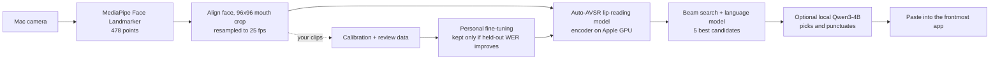

# Silent Dictation

Type by silently mouthing words at your Mac's camera. No microphone, no wearable, nothing leaves your Mac.

Hold **Right Option**, mouth a sentence without making a sound, release, and the text is pasted where your
cursor is, the same way voice dictation apps like Willow Voice work, but usable in a quiet office or on a train.

> Inspired by [Aarush Yadav's Subvocal announcement](https://x.com/AarushYadav47/status/2116198463847408066),
> which reads silent mouthing with glasses. This project asks how far the camera already on your laptop can go.
> It is an independent open-source experiment and is not affiliated with Subvocal.

**Status: early prototype, English only.** Lip reading is hard: the base model makes many mistakes on a new
person's silent speech. The built-in calibration measures *your* error rate and trains a personal model, and
the review loop keeps improving it as you use it.

## How it works



Everything runs locally on Apple Silicon: PyTorch (MPS) for lip reading, MLX for the optional language model.

## Install

Requirements: a Mac with Apple Silicon (tested on macOS 26), about 6 GB of disk, and [uv](https://docs.astral.sh/uv/).

```sh
brew install uv
git clone https://github.com/KeWang0622/silent-dictation.git
cd silent-dictation
./setup.sh                 # Python env + checksum-verified models (add --no-llm to skip the 2 GB LLM)
bin/silentdict doctor --prompt --camera-test
```

macOS asks for three permissions for the app you run this from (Terminal, iTerm, VS Code...):
**Camera**, **Input Monitoring** (to see the push-to-talk key) and **Accessibility** (to paste).
Grant them in System Settings > Privacy & Security, then restart that app.

## 1. Calibrate (about 5 minutes)

```sh
bin/silentdict calibrate
```

A window shows one sentence at a time. Hold Right Option, mouth it silently the way you will in public,
release. After each sentence you see what the base model read and your running word error rate.
Keys: `r` redo, `s` skip, `q` finish. Put your own frequent phrases in `prompts/custom.txt`; they are recorded first.

When you finish (60 sentences by default, at least 20), the personal model is trained and evaluated:

- every 5th sentence is held out permanently, so the score is measured on sentences the model never trained on;
- training always restarts from the public model and uses all your clips;
- the personal model, the language-model weight and the LLM rewrite are each enabled only if they lower
  your held-out word error rate. Results are appended to `data/personal/reports/progress.csv`.

## 2. Dictate

```sh
bin/silentdict run
```

Click into any text field, hold **Right Option**, mouth, release. A small preview window shows the mouth box and
what was read; `q` in that window quits. Typing another key while holding Option (for example Option+E) cancels,
so normal shortcuts keep working.

Useful options: `--key right_command`, `--camera 1` (for example an iPhone Continuity Camera), `--no-llm`,
`--no-paste` (print only), `--no-preview`, `--no-history`. Add frequent names and jargon to
`data/personal/context.txt`; the local LLM uses them to resolve look-alike words.

## 3. Keep improving accuracy

```sh
bin/silentdict review      # confirm (Enter) or correct recent dictation
bin/silentdict train       # retrain from calibration + reviewed clips
bin/silentdict eval        # base vs personal model on your held-out clips
```

`run` keeps the 96×96 grey mouth crops of recent dictation (last 500) so you can turn them into labelled
training data with `review`. More confirmed sentences means a better personal model; `progress.csv` shows the trend.

## Privacy

Video never leaves the Mac and is never written to disk as full frames. Only 96×96 greyscale mouth crops and
their text are stored, in `data/` (git-ignored). Delete that folder to erase everything, or run with `--no-history`.
After `setup.sh` no network access is needed.

## What has been verified

On an Apple M5 Max with macOS 26:

| Check | Result |
|---|---|
| Full camera pipeline on the public Auto-AVSR demo clip (face video, 8.6 s) | 2 word errors out of 22 (missed "face and") |
| Beam-search speed-up from caching cross-attention (identical outputs) | 4.1 s → 1.1 s for a 6–7 s clip |
| Latency for a typical 3 s sentence | about 1 s on an idle machine, plus about 0.3 s for the LLM |
| Personal fine-tuning sanity check | model learns a new target sentence for a clip; loss 87 → 5.8 |
| Live camera smoke test | 30 fps capture, face found in 70 of 76 frames, crop and decode completed |

Your silent-speech accuracy is not known until you calibrate; the calibration report gives that number.

## Troubleshooting

- **Black camera image**: the lens may be covered, or another camera is better; try `--camera 1`.
  `bin/silentdict doctor --camera-test` reports brightness and face detection.
- **Nothing happens when holding Option**: Input Monitoring is missing for your terminal app.
- **Text not pasted**: Accessibility is missing; `--no-paste` prints results instead.
- **Test without a camera**: `bin/silentdict transcribe video.mp4`, or `run --camera video.mp4` to replay a file as a camera.

## Roadmap

- FLARE encoder (13.2% WER on LRS3 vs 19.1% for the current model; MIT-licensed code and public weights).
- LoRA adaptation, streaming decoding, a menu-bar app, Mandarin. See [docs/RESEARCH.md](docs/RESEARCH.md).

## Credits and licences

- Idea: [Aarush Yadav / Subvocal](https://x.com/AarushYadav47/status/2116198463847408066).
- [Chaplin](https://github.com/amanvirparhar/chaplin) by Amanvir Parhar (MIT): the original real-time lip-reading
  typing tool this project builds on.
- [Auto-AVSR](https://github.com/mpc001/auto_avsr) by Pingchuan Ma et al.: model, preprocessing and
  [ESPnet](https://github.com/espnet/espnet) code (Apache-2.0).
- [MediaPipe](https://github.com/google-ai-edge/mediapipe), [MLX](https://github.com/ml-explore/mlx),
  [Qwen3](https://huggingface.co/Qwen) (Apache-2.0).

Code in this repository is Apache-2.0 (see [LICENSE](LICENSE) and [NOTICE](NOTICE)).
**The default lip-reading weights are released by their authors for non-commercial research use**; they are
downloaded separately by `setup.sh`, are not covered by this licence, and personal models fine-tuned from them
inherit their terms.

---

## 中文说明

对着 Mac 摄像头无声做口型就能打字：按住右 Option，不出声地说一句话，松开后文字会粘贴到当前光标处。
全程本地运行，不需要麦克风，也不需要戴任何设备。灵感来自 [Aarush Yadav 发布的 Subvocal](https://x.com/AarushYadav47/status/2116198463847408066)，本项目与 Subvocal 无关联。

1. `./setup.sh`：安装环境和模型；`bin/silentdict doctor --prompt --camera-test`：检查摄像头和权限。
2. `bin/silentdict calibrate`：约 5 分钟，逐句无声读屏幕上的英文句子；结束后自动训练个人模型，并用固定留出的句子比较校准前后的词错误率。
3. `bin/silentdict run`：日常输入。
4. `review` → `train`：确认或修改最近的识别结果，把它们加入训练数据，持续提高准确率。

目前只支持英文。默认唇读权重仅限非商业研究用途；代码采用 Apache-2.0。
