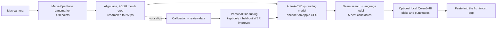

# Silent Dictation

Type by silently mouthing words at your Mac's camera. No microphone, no wearable, nothing leaves your Mac.

Hold **fn**, mouth a sentence without making a sound, release, and the text is pasted where your cursor is,
the same way voice dictation apps like Willow Voice work, but usable in a quiet office or on a train.
It runs as a small menu-bar app with a floating indicator at the bottom of the screen.

> Inspired by [Aarush Yadav's Subvocal announcement](https://x.com/AarushYadav47/status/2116198463847408066),
> which reads silent mouthing with glasses. This project asks how far the camera already on your laptop can go.
> It is an independent open-source experiment and is not affiliated with Subvocal.

**Status: early prototype, English only.** Lip reading is hard: the base model makes many mistakes on a new
person's silent speech. The built-in calibration measures *your* error rate and trains a personal model, and
the review loop keeps improving it as you use it.

## How it works



Everything runs locally on Apple Silicon: PyTorch (MPS) for lip reading, MLX for the optional language model.

## Install

Requirements: a Mac with Apple Silicon (tested on macOS 26), about 6 GB of disk, and [uv](https://docs.astral.sh/uv/).

```sh
brew install uv
git clone https://github.com/KeWang0622/silent-dictation.git
cd silent-dictation
./setup.sh                 # Python env + checksum-verified models (add --no-llm to skip the 2 GB LLM)
bin/build-app --install    # builds "Silent Dictation.app" and copies it to /Applications
```

Open **Silent Dictation** from Spotlight or Launchpad. The app uses the code and models in the folder you cloned,
so keep that folder in place. If it is inside Documents, Desktop or Downloads, macOS first asks whether
Silent Dictation may access that folder: click Allow. Cloning somewhere like `~/Developer` avoids that prompt.

The setup window walks you through three permissions: **Camera**, **Input Monitoring** (to notice the key) and
**Accessibility** (to paste). Restart the app after granting Input Monitoring. Rebuilding the app gives it a new
signature, so macOS may ask for these permissions again.

## Using the app

| Action | What happens |
|---|---|
| Hold **fn**, mouth a sentence, release | the sentence is lip-read and pasted at your cursor |
| Double-tap **fn** | hands-free mode; press fn once more to finish |
| fn together with another key (e.g. fn+arrow) | ignored, so normal shortcuts keep working |
| Menu bar icon | calibration, review, training, camera preview, key, camera and LLM settings |

The floating indicator shows *Starting camera* (yellow; wait for red), *Reading lips* (red, with a live mouth
preview), *Decoding*, and then the text. By default the camera turns off two minutes after you last used it;
the menu can keep it always on (fastest) or on only while dictating.

If **Willow Voice** (or another dictation app) also uses fn, both start together. Pick Right Option in the
Silent Dictation menu, change the other app's key, or quit it while you are in public. Setting
System Settings › Keyboard › "Press 🌐 key to" to **Do Nothing** stops fn from opening the emoji picker.

## 1. Calibrate (about 5 minutes)

Choose **Calibrate…** in the menu (or click it in the setup window). A window shows one sentence at a time:
hold fn, mouth it silently the way you will in public, release. After each sentence you see what the base model
read and your running word error rate. When you click **Finish & train** (60 sentences by default, at least 20),
the personal model is trained and evaluated:

- every 5th sentence is held out permanently, so the score is measured on sentences the model never trained on;
- training always restarts from the public model and uses all your clips;
- the personal model, the language-model weight and the LLM rewrite are each enabled only if they lower
  your held-out word error rate. Results are appended to `data/personal/reports/progress.csv`.

Put your own frequent phrases in `prompts/custom.txt`; they are recorded first. Add names and jargon to
`data/personal/context.txt`; the local LLM uses them to resolve look-alike words.

## 2. Keep improving accuracy

**Review Recent Dictation…** shows each recent clip with its text: save it if it is right, or type what you meant
and save. **Train Personal Model** retrains from calibration plus reviewed clips, and the menu shows the latest
held-out word error rate. More confirmed sentences means a better personal model.

## Command line

Everything is also available without the app, for scripting and debugging (run from a terminal that has the
Camera, Input Monitoring and Accessibility permissions; the default key there is Right Option):

```sh
bin/silentdict doctor --camera-test   # models, permissions, camera
bin/silentdict calibrate              # OpenCV calibration window
bin/silentdict run --key fn           # dictation without the menu-bar app
bin/silentdict review | train | eval  # improve and measure the personal model
bin/silentdict transcribe video.mp4   # lip-read a file
```

## Privacy

Video never leaves the Mac and is never written to disk as full frames. Only 96×96 greyscale mouth crops and
their text are stored, in `data/` (git-ignored). Delete that folder to erase everything, or turn off
*Keep Clips for Review* in the menu. After `setup.sh` no network access is needed.

## What has been verified

On an Apple M5 Max with macOS 26:

| Check | Result |
|---|---|
| Full camera pipeline on the public Auto-AVSR demo clip (face video, 8.6 s) | 2 word errors out of 22 (missed "face and") |
| Beam-search speed-up from caching cross-attention (identical outputs) | 4.1 s → 1.1 s for a 6–7 s clip |
| Latency for a typical 3 s sentence | about 1 s on an idle machine, plus about 0.3 s for the LLM |
| Personal fine-tuning sanity check | model learns a new target sentence for a clip; loss 87 → 5.8 |
| Live camera smoke test | 30 fps capture, face found in 70 of 76 frames, crop and decode completed |
| App gestures (replayed video, no real key events) | hold → read → paste flow, double-tap hands-free, fn+key cancel |
| Fresh clone + `./setup.sh` | all model checksums verified; `doctor` and `transcribe` pass |

Your silent-speech accuracy is not known until you calibrate; the calibration report gives that number.

## Troubleshooting

- **Black camera image**: the lens may be covered. Pick another camera in the menu (for example an iPhone
  Continuity Camera); **Camera Preview…** shows what the app sees.
- **Nothing happens when holding fn**: Input Monitoring is missing, or the app needs a restart after granting it.
- **Text appears in the clipboard but is not pasted**: Accessibility is missing.
- **The app does not start**: check `data/app.log` in the project folder.
- **Test without a camera**: `bin/silentdict transcribe video.mp4`, or `run --camera video.mp4` to replay a file as a camera.

## Roadmap

- FLARE encoder (13.2% WER on LRS3 vs 19.1% for the current model; MIT-licensed code and public weights).
- LoRA adaptation, streaming decoding, a signed stand-alone app bundle, Mandarin. See [docs/RESEARCH.md](docs/RESEARCH.md).

## Credits and licences

- Idea: [Aarush Yadav / Subvocal](https://x.com/AarushYadav47/status/2116198463847408066).
- [Chaplin](https://github.com/amanvirparhar/chaplin) by Amanvir Parhar (MIT): the original real-time lip-reading
  typing tool this project builds on.
- [Auto-AVSR](https://github.com/mpc001/auto_avsr) by Pingchuan Ma et al.: model, preprocessing and
  [ESPnet](https://github.com/espnet/espnet) code (Apache-2.0).
- [MediaPipe](https://github.com/google-ai-edge/mediapipe), [MLX](https://github.com/ml-explore/mlx),
  [Qwen3](https://huggingface.co/Qwen) (Apache-2.0).

Code in this repository is Apache-2.0 (see [LICENSE](LICENSE) and [NOTICE](NOTICE)).
**The default lip-reading weights are released by their authors for non-commercial research use**; they are
downloaded separately by `setup.sh`, are not covered by this licence, and personal models fine-tuned from them
inherit their terms.

---

## 中文说明

对着 Mac 摄像头无声做口型就能打字：按住 fn，不出声地说一句话，松开后文字会粘贴到当前光标处；双击 fn 进入免按住模式。
全程本地运行，不需要麦克风，也不需要戴任何设备。灵感来自 [Aarush Yadav 发布的 Subvocal](https://x.com/AarushYadav47/status/2116198463847408066)，本项目与 Subvocal 无关联。

1. `./setup.sh` 安装环境和模型，`bin/build-app --install` 生成并安装 “Silent Dictation” App。
2. 打开 App，按设置窗口允许摄像头、输入监控、辅助功能。
3. 菜单栏图标 › 校准：约 5 分钟，结束后自动训练个人模型，并用固定留出的句子比较校准前后的词错误率。
4. 菜单栏图标 › 复查最近的输入 › 训练个人模型：持续提高准确率。界面语言可在菜单里切换为中文。

目前只支持英文。默认唇读权重仅限非商业研究用途；代码采用 Apache-2.0。
